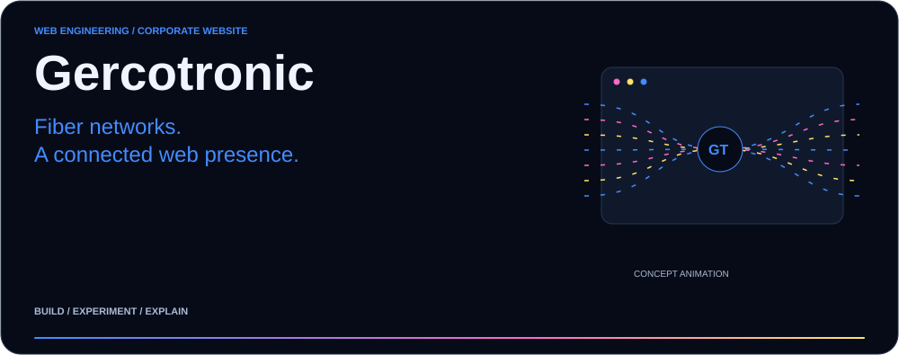
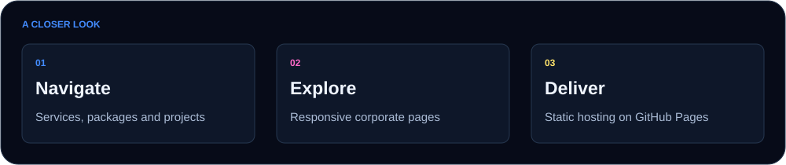

<picture>
  <source media="(max-width: 600px)" srcset="docs/readme/hero-mobile.svg">
  
</picture>

<a href="https://bakk0u.github.io/gercotronic-preview/"><b>Open website ↗</b></a> &nbsp; · &nbsp; <a href="index.html"><b>Source ↗</b></a> &nbsp; · &nbsp; <a href="#technical-reference"><b>Project notes ↗</b></a>

A multi-page corporate website implementation using HTML, TailwindCSS and vanilla JavaScript, with a public GitHub Pages demo.

## Evidence at a glance

| Focus | What this repository contains |
| :--- | :--- |
| **Pages** | Services, packages, projects, about and contact. |
| **Implementation** | Responsive layouts and shared navigation conventions. |
| **Hosting** | Static deployment and relative-path routing. |

## How the pieces fit

<picture>
  <source media="(max-width: 600px)" srcset="docs/readme/workflow-mobile.svg">
  
</picture>

## Getting started

Use the source and project documents linked above. Detailed notes are available below.

## Technical reference

<b>Methods and implementation</b>

## Features

- Multi-page architecture (Services, Packages, Projects, About, Contact)
- Responsive design with TailwindCSS
- Clean navigation structure optimized for GitHub Pages deployment
- Legal compliance pages (Impressum & Datenschutz)
- Scalable component-based layout

<b>Project context and reference</b>

# Gercotronic Website

A modern, multi-page corporate website built with HTML, TailwindCSS, and modular design principles.

## Tech Stack

- HTML5
- TailwindCSS (CDN)
- Vanilla JavaScript
- GitHub Pages (deployment)

## Live Demo

https://bakk0u.github.io/gercotronic-preview/

## Highlights

- Resolved real-world deployment issues (routing, relative paths, static hosting constraints)
- Converted template-based UI into a structured production-ready site
- Implemented consistent navigation across all pages

## Future Improvements

- SPA-style navigation (AJAX / JS routing)
- Backend integration (Strapi / API)
- Animations (GSAP)
- SEO optimization

---

Built as part of a professional web development workflow.

